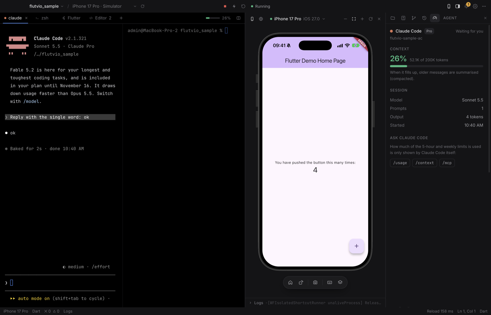
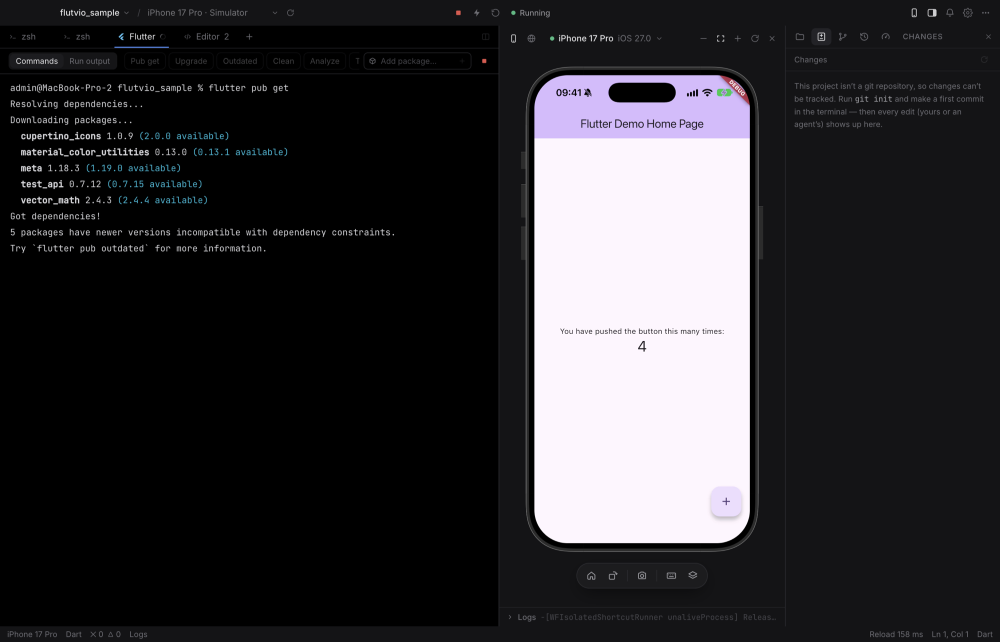
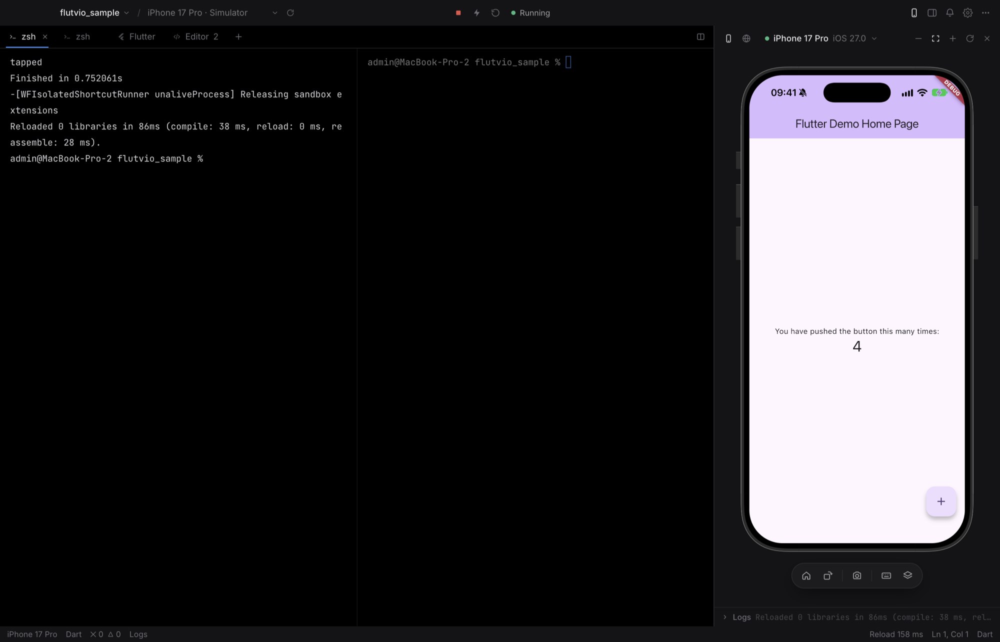
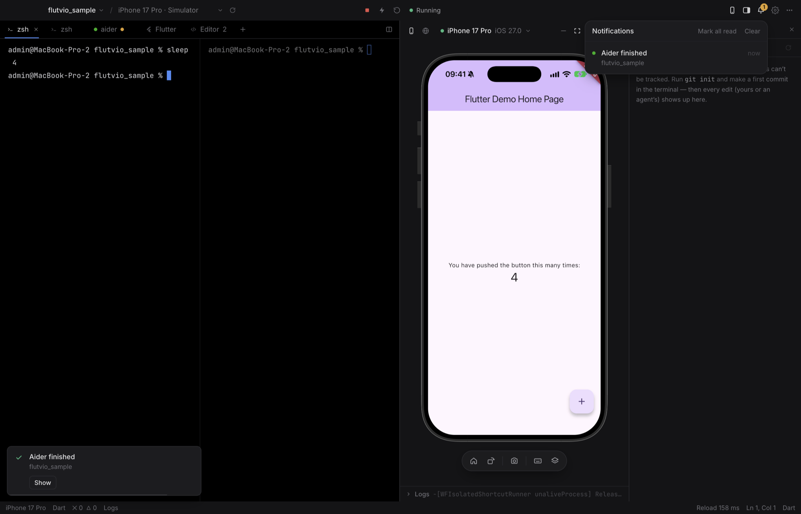
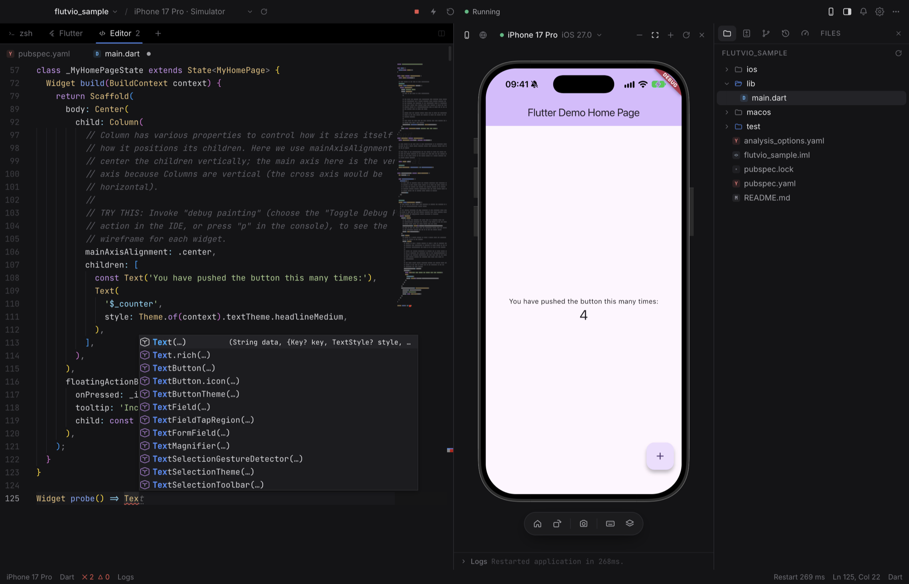
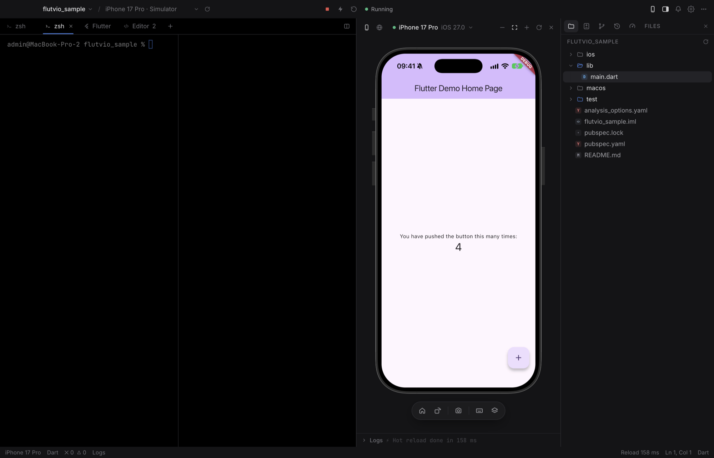
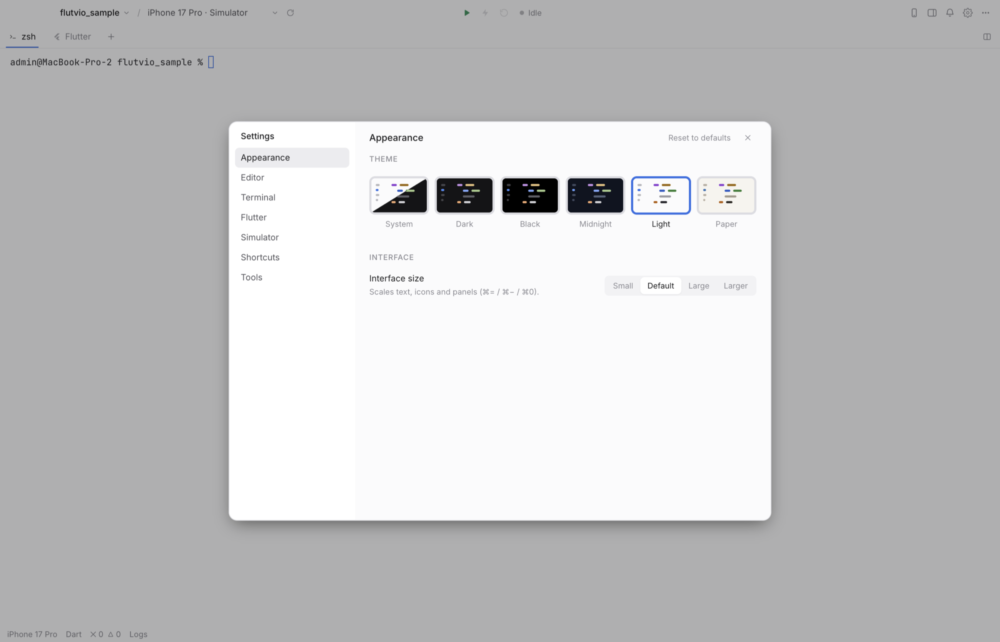

<div align="center">


# Flutvio

**A terminal-first macOS workspace for Flutter — run any AI coding agent, wired to the iOS Simulator.**

[](https://github.com/haithemnini/flutvio/releases/latest)
[](LICENSE)
-lightgrey)

[](CONTRIBUTING.md)

[**Download for macOS**](https://github.com/haithemnini/flutvio/releases/latest) · [Features](#features) · [Install](#install) · [The `flutvio` command](#the-flutvio-command) · [Roadmap](#roadmap)



</div>

---

## Why Flutvio

AI coding agents — Claude Code, OpenCode, Codex, Gemini CLI, Aider — live in the terminal. Flutter development lives in a simulator. Today those are two separate windows, and the agent is blind: it edits your Dart code but cannot see the screen it just changed, tap a button, or read the app's logs.

Flutvio puts them in one window and connects them:

- **The terminal is the main pane**, not a small panel at the bottom of an editor. Whatever agent you run in it is the "AI" of the workspace — nothing is hard-coded to one vendor.
- **The iOS Simulator sits beside it**, mirrored live at 60 fps, and you can touch it.
- **A `flutvio` command is on the PATH of every terminal**, so the agent can hot reload, take a screenshot, read what is on screen, tap, type, and read the logs — and check its own work.

Everything else an IDE has (files, an editor, git, diffs) is there, but out of the way until you ask for it.

## Features

### Terminal first
- Full terminal (xterm.js + a real PTY): tabs, up to four split panes, 10,000 lines of scrollback.
- **Tabs name themselves** after what runs in them — `zsh` → `claude` → `zsh` — with the agent's colour and a pulse while it works.
- Mac editing keys work the way you expect: hold ⌫, ⌥⌫ word, ⌘⌫ line, ⌥←/→, ⌘←/→, ⇧↩ for a new line in agent prompts.
- **Arabic and other right-to-left text reads correctly** in the terminal — a first-class concern, not an afterthought.

### Any agent, connected to the simulator
- Works with any CLI agent: Claude Code, OpenCode, Codex, Gemini CLI, Aider, Cursor Agent, Amp, Goose…
- The [`flutvio` command](#the-flutvio-command) lets the agent see and drive the simulator and the running app.
- One click adds a short section about it to your project's `AGENTS.md`.
- **Sessions**: browse and resume past Claude Code, OpenCode, Codex and Gemini sessions for the project.

### Agent panel
- For Claude Code: **how full the context window is**, model, plan, prompts sent, compactions, and "limit reached — resets at …".
- A small context meter in the tab strip, visible while you type.
- **MCP servers and connectors** with their real status (connected / needs sign-in / failed).
- Read from the agent's own local files. Nothing is sent anywhere.

### Notifications
- When an agent finishes its turn, or asks for you, while you are in another tab or another app: a dot on the tab, a bell with a count, a toast, a macOS notification and a Dock badge. Click to jump to that terminal.
- Long commands (builds, tests) that end in the background notify too.

### Flutter built in
- Run, stop, **hot reload** and hot restart from the title bar or the keyboard; hot reload on save.
- **Embedded iOS Simulator**: Xcode's own simulator mirrored in the window (H.264 over `idb_companion`), with touch, keyboard, hardware buttons, rotation and screenshots. Off until you open it — closed means nothing runs.
- **Flutter tab**: a dedicated shell with `pub get`, upgrade, outdated, clean, analyze, test, doctor, builds and "add package" one click away, plus the running app's output.
- Device picker for every device `flutter` lists.

### The rest of an IDE, when you want it
- **Changes**: a live "Files changed" view — watch an agent's edits appear as diffs while it works.
- **Git**: stage, commit, push, pull, branches, history graph, **git worktrees**, and GitHub pull requests (list, review, create, merge) through the `gh` CLI.
- **Editor**: Monaco with Dart completion, errors, hover, go-to-definition and format on save (Dart language server).
- File tree, built-in browser pane, five themes, a searchable keyboard-shortcut list.

## Screenshots

| | |
|---|---|
| **Flutter tab** — everyday commands and the app's output<br> | **Driving the app from the terminal** with `flutvio`<br> |
| **Notifications** when an agent finishes elsewhere<br> | **Editor** with Dart completion<br> |
| **Split terminals**<br> | **Themes**<br> |

## Install

1. Download **`Flutvio-<version>-mac-arm64.dmg`** from the [latest release](https://github.com/haithemnini/flutvio/releases/latest).
2. Open it and drag **Flutvio** to **Applications**.
3. Launch it. The app is signed with a Developer ID and **notarized by Apple**, so it opens without warnings.

The app is open source and built from this repository; you can also [build it yourself](#build-from-source). Each release lists SHA-256 checksums.

### Requirements

| | |
|---|---|
| **macOS on Apple Silicon** | Intel Macs: build from source (untested). |
| **Flutter SDK** | On your `PATH`, or set `FLUTVIO_FLUTTER` to the `flutter` binary. |
| **Xcode** | For the iOS Simulator. |
| **idb-companion** | For the embedded simulator: `brew install facebook/fb/idb-companion` |
| **fb-idb** *(optional)* | Only for `flutvio elements`: `python3 -m venv ~/.flutvio-idb && ~/.flutvio-idb/bin/pip install fb-idb` |
| **git**, **gh** *(optional)* | Git features; `gh` for GitHub pull requests. |
| **An agent** *(optional)* | Claude Code, OpenCode, Codex, Gemini CLI… whatever you use. |

The welcome guide and **Settings › Tools** check all of these and tell you what is missing.

## Quick start

1. Open Flutvio and choose a Flutter project (or create / clone one from the welcome screen).
2. You land in a terminal in the project folder. Start your agent: `claude`, `opencode`, `codex`, `gemini`…
3. Open the simulator with the phone button (⇧⌘M), pick a device, press **Run** (⌘R).
4. Ask the agent to change the UI — and to check it with `flutvio reload` and `flutvio screenshot`.

## The `flutvio` command

Available in every Flutvio terminal. It talks to the app over `127.0.0.1` with a random per-launch token, so it only works from inside Flutvio.

```text
flutvio status                     project, device, app state, simulator
flutvio screenshot [file.png]      save what the simulator shows; prints the file path
flutvio elements                   on-screen elements with their tap points
flutvio tap <x> <y>                tap at a point
flutvio swipe <x1> <y1> <x2> <y2>  swipe / scroll
flutvio type <text>                type into the focused field
flutvio button <home|lock|siri>    press a hardware button
flutvio run | stop                 start / stop the Flutter app
flutvio reload | restart           hot reload / hot restart
flutvio logs [-n <lines>]          recent Flutter output
```

A typical agent loop: **edit code → `flutvio reload` → `flutvio screenshot` → look at the image → fix**.

To tell agents about it, use **Settings › Tools › Add instructions to AGENTS.md**.

## Keyboard shortcuts

| | | | |
|---|---|---|---|
| ⌘T | New terminal | ⌘R / ⌘. | Run / stop |
| ⌘D | Split terminal | ⌘\\ | Hot reload |
| ⇧⌘F | Flutter tab | ⇧⌘\\ | Hot restart |
| ⌘B | Side panel | ⇧⌘M | Simulator |
| ⌘J | Changes | ⇧⌘A | Agent panel |
| ⌘K | Clear terminal | ⇧⌘5 | Screenshot |
| ⌘1…9 | Go to tab | ⌘/ | All shortcuts |

## Build from source

Requires Node.js 20+ and Xcode command line tools.

```bash
git clone https://github.com/haithemnini/flutvio.git
cd flutvio/flutvio-ide
npm install
npx electron-rebuild -f -w node-pty
npm run dev          # run with hot reload
```

```bash
npm run typecheck    # TypeScript, main + renderer
npm test             # unit tests
npm run dist         # build Flutvio.app, .dmg and .zip into release/
```

See [CONTRIBUTING.md](CONTRIBUTING.md) for the end-to-end UI test and project conventions.

## Architecture

Electron 45 · React 19 · TypeScript · Tailwind CSS · Vite (electron-vite).

```text
flutvio-ide/src
├── shared/flutvio-api.ts     the typed IPC contract (one source of truth)
├── main/                     Node side
│   ├── ptyManager.ts         terminals (node-pty), tab titles, clean shell environment
│   ├── flutterDaemon.ts      `flutter run --machine` JSON-RPC
│   ├── flutterService.ts     project / device / run state machine
│   ├── simulatorBridge.ts    idb_companion over gRPC: H.264 video + touch/keys
│   ├── agentBridge.ts        local HTTP bridge behind the `flutvio` command
│   ├── agentMonitor.ts       agent activity, Claude Code context / limits / MCP
│   ├── aiSessions.ts         past agent sessions
│   ├── gitService.ts         git + GitHub (gh)
│   └── dartLsp.ts            Dart language server
├── preload/index.ts          contextBridge → window.flutvio (no raw ipcRenderer)
└── renderer/src              React UI: Workspace, Terminal, Simulator, SidePanel, Editor…
```

The renderer never touches Node APIs; every capability goes through the typed bridge.

## Status and limitations

Flutvio **0.1.0 is a first public preview** — expect rough edges.

- **Apple Silicon only** for the downloadable build.
- **Only the iOS Simulator is embedded and tested.** Other devices Flutter lists (physical iPhones, Android, macOS) can be selected and run, but are not mirrored in the window and have not been verified.
- **One project per window.**
- **Agent panel details are Claude Code only.** Other agents show working / waiting, inferred from terminal output.
- **Usage-limit percentages are not shown** — Claude Code does not store them locally. The panel shows when a limit is hit and when it resets; `/usage` in the agent shows the rest.
- The context-window size is an estimate (200K, or 1M once a session passes 200K).
- No auto-update yet: download new versions from Releases.

## Roadmap

- A universal (Intel + Apple Silicon) build
- Several projects in one window, with agent status per project
- Android emulator mirroring (scrcpy)
- Terminal search, session restore
- An MCP server on top of the agent bridge
- Auto-update

See [ROADMAP.md](ROADMAP.md) and [CHANGELOG.md](CHANGELOG.md).

## Privacy

Flutvio has no account, no telemetry and no server. The `flutvio` bridge listens on `127.0.0.1` only, with a random token per launch. Agent session data is read from the agents' own local files and is never uploaded. Network traffic is whatever your tools (Flutter, git, your agent) make themselves.

## Contributing

Issues and pull requests are welcome — see [CONTRIBUTING.md](CONTRIBUTING.md). Good first areas: Android mirroring, terminal search, more agents in the Agent panel.

## Credits

Built on [Electron](https://www.electronjs.org), [xterm.js](https://xtermjs.org), [node-pty](https://github.com/microsoft/node-pty), [Monaco Editor](https://microsoft.github.io/monaco-editor/) and [idb](https://github.com/facebook/idb). The terminal-first layout is inspired by cmux.

Flutter and Dart are trademarks of Google LLC. Claude is a trademark of Anthropic. Flutvio is an independent project and is not affiliated with either.

## License

[MIT](LICENSE) © 2026 Haithem Nini
